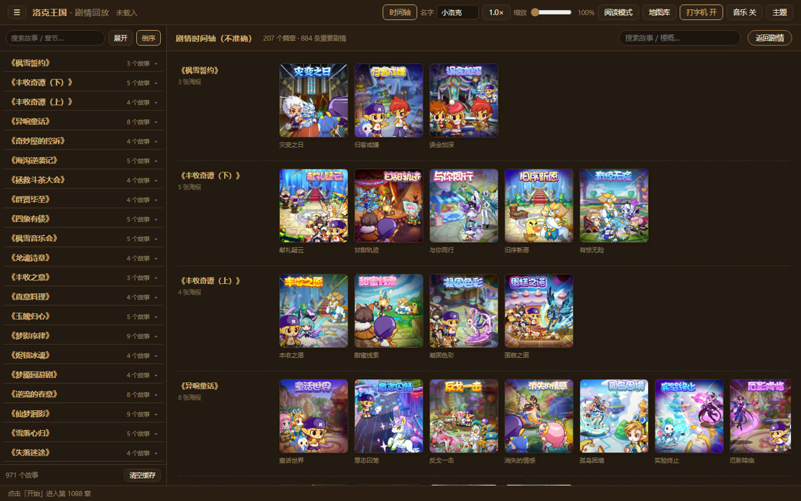

# 洛克王国怀旧播放器

在浏览器里回放《洛克王国》的剧情：地图、角色、对话框、过场动画和背景音乐都按官方脚本还原。
纯前端 + 一个本地小服务，所有资源在运行时从官方 CDN 拉取，仓库里不存放图片 / 音频 / SWF。

## 运行

Windows：双击 `启动播放器.cmd`，什么都不用装。

它会按顺序找 Node.js：项目里的 `runtime\node.exe` → 系统 PATH 上的 node（需 18+）→
都没有就自动下载一份便携版（约 30MB，只第一次），然后起服务并用默认浏览器打开播放器。

macOS / Linux：`./start.sh`，逻辑一样。

首次运行那条下载走国内镜像（`cdn.npmmirror.com`），不通再退到 nodejs.org；
两条都失败时窗口里会告诉你手动装 Node.js 18+ 的地址。

命令行等价于 `node proxy/server.mjs --open`。地址是 http://127.0.0.1:8787/ ，关掉那个命令行窗口就停止服务。

## 为什么需要本地服务

官方资源服务器不返回 `Access-Control-Allow-Origin`，浏览器的 `fetch` 拿不到。
`proxy/server.mjs` 同时做两件事：静态托管这个目录、把 `/proxy?url=...` 转发到
`res.17roco.qq.com` 并补上 CORS 头。它只监听 127.0.0.1，不对外提供服务。

## 资源边界

仓库里**没有**官方图片、音频、SWF。所有贴图、音乐、过场都是运行时按官方脚本里的路径
从 `res.17roco.qq.com` 取的。

仓库里**有**的是播放器代码、Ruffle（`vendor/ruffle`，MIT/Apache-2.0，随包分发）、
以及一份很小的索引数据（`data/*.json`：章节号、标题、官方日期、地图与音乐的对应关系等）。

另外带了 `data/ats/`：2010–2012 那批老故事的剧本是 Flash 的 `.ats` 二进制，官方没有提供 XML 版本，这里是从 `.ats` 里还原出的文本，约 2.5MB。

## 目录

- `index.html` / `css` / `js`：播放器本体
- `proxy/server.mjs`：静态服务 + CDN 转发
- `vendor/ruffle`：Flash 运行时
- `data`：章节索引、地图表、动画分类表
- `data/ats`：从官方 `.ats` 还原的老故事剧本
- `启动播放器.cmd` / `start.sh`：一键启动

## 致谢

Ruffle（https://ruffle.rs）提供 Flash 运行时；剧情、美术、音乐的版权属于腾讯《洛克王国》。
本项目只做播放，不提供任何资源下载服务。

## 许可证

播放器代码用 MIT，见 `LICENSE`。`vendor/ruffle` 是第三方构建产物，按其自身许可证
（MIT / Apache-2.0）分发，见 `THIRD-PARTY-NOTICES.md`。
