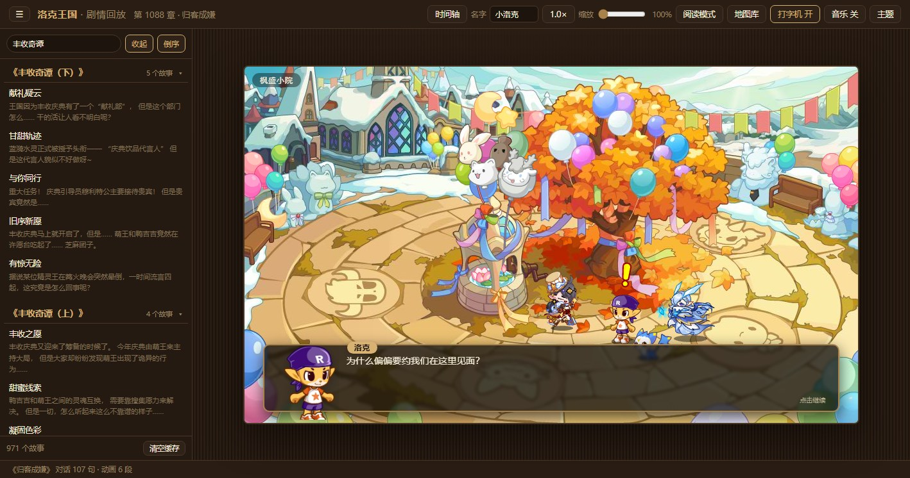
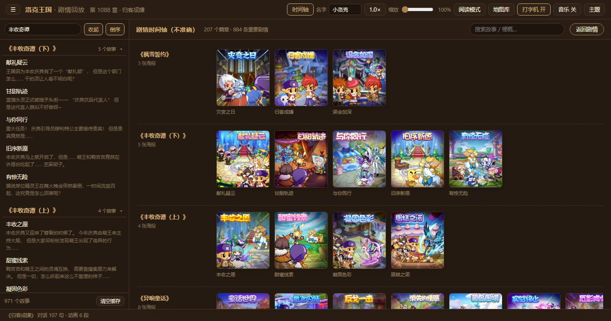
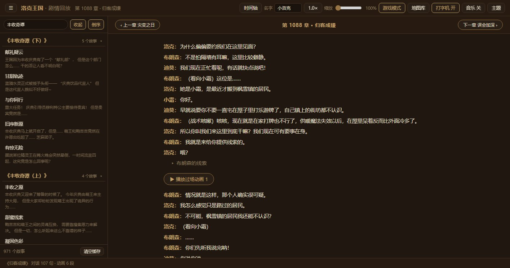

# 洛克王国 · 剧情回放

在浏览器里回放网页游戏《洛克王国》的剧情：地图、NPC、立绘、对话框、选项、过场动画和背景音乐，都按官方脚本原样还原。不用装游戏客户端，也不用装 Flash 插件。



> 本项目与腾讯公司及《洛克王国》项目组无关，仅供怀旧与学习交流。剧情文本、美术、音乐的著作权归官方所有，仓库内不存放任何官方美术、音频或 SWF 文件。

---

## 一、安装与运行

整个项目没有安装包，也不需要注册账号。下载、解压、双击，三步就能用。

### 第 1 步：下载

打开项目页面 <https://github.com/lecunun/luoke-player>，点右上角绿色的 **Code** 按钮，在弹出菜单里选 **Download ZIP**。浏览器会下载一个 `luoke-player-main.zip`，约 31 MB。

会 git 的话也可以直接克隆：

```bash
git clone https://github.com/lecunun/luoke-player.git
```

### 第 2 步：解压（这一步不能省）

把 zip 解压到任意文件夹，例如 `D:\洛克王国剧情`。**必须先解压再运行**，不能在压缩包里直接双击：压缩包里的文件是只读的，程序第一次启动要往项目里写一份 Node.js 运行时，只读状态会失败。

解压正确的话，文件夹里应该能看到这些：

```
启动播放器.cmd      <- Windows 双击这个
start.sh            <- macOS / Linux 用这个
index.html
css/  js/  data/  proxy/  vendor/
tools/  img/
```

### 第 3 步：启动

**Windows**：双击 `启动播放器.cmd`。

- 第一次运行会弹出一个黑色窗口，提示没有找到 Node.js，然后自动下载一份便携版（约 30 MB），存到项目的 `runtime` 文件夹。
- 下载完成后，浏览器会自动打开 `http://127.0.0.1:8787/`，直接就能看。
- **黑色窗口不要关**，它是本地服务器，关掉服务就停了。最小化即可。
- 之后再次启动只用一两秒，不会重复下载。

如果 Windows 弹出"已保护你的电脑"或"打开文件 - 安全警告"（这是系统对"从网上下载、没有代码签名的脚本"的统一提示，不是病毒报警），点 **更多信息 → 仍要运行**，或"运行"。想一劳永逸，可以在解压之前右键 zip → 属性 → 勾选 **解除锁定** → 确定，再解压，之后就不会再弹。

**macOS / Linux**：在项目文件夹里打开终端，执行

```bash
chmod +x start.sh
./start.sh
```

macOS 第一次运行可能提示"无法验证开发者"，在 **系统设置 → 隐私与安全性** 里点"仍要打开"。

### 关闭

关掉那个黑色窗口即可。浏览器标签页可以留着，下次启动还是同一个地址。

### 卸载

**删掉整个项目文件夹就卸载完了。** 没有安装程序，不写注册表，不装后台服务，不设开机启动，不往系统目录放任何文件。第一次启动自动下载的 Node 运行时就在文件夹里的 `runtime` 目录，会跟着一起删掉。

唯一留在文件夹外面的是浏览器缓存：播放器会把看过的剧本、地图、音乐存进浏览器的 IndexedDB（库名 `luoke-story`）。想清干净，在播放器左下角点 **清空缓存**，或者在浏览器设置里清除本站的站点数据。

### 装不上怎么办

| 现象 | 大概率原因 | 处理办法 |
| --- | --- | --- |
| 双击后黑窗口一闪就消失 | 文件被系统标记拦截 | 右键 zip → 属性 → 解除锁定 → 重新解压再双击 |
| 提示 Node.js not found，随后下载也失败 | 几个下载源都不通 | 手动安装 Node.js 18 以上版本（<https://nodejs.org/>），再双击启动脚本 |
| 浏览器没有自动打开 | 默认浏览器被占用或被拦 | 手动在地址栏输入 `http://127.0.0.1:8787/` |
| 提示端口 8787 已被占用 | 已经开着一个播放器窗口 | 直接用已打开的那个页面，关掉多余的黑窗口 |
| 页面一片空白、动画不动 | 首次加载要从官方服务器取资源，网慢 | 等十几秒，或按 F5 刷新；反复出现见下方"使用提示" |
| 杀毒软件报警 | 启动脚本会调用 `curl` 下载 Node | 允许即可，也可以手动装 Node 之后就不再触发下载 |
| 断网 / 公司网络限制 | 所有素材都在官方服务器上 | 本工具不提供离线素材，必须能访问 `res.17roco.qq.com` |

---

## 二、项目介绍

一个纯本地的复古播放器：把《洛克王国》十几年来散落在任务系统里的剧情，按章节重新组织起来，用 Ruffle（Flash 模拟器）在浏览器里逐帧放给你看。它不修改游戏、不连接游戏账号，只读取官方资源服务器上的公开文件。

### 收录内容

| 项目 | 规模 | 说明 |
| --- | --- | --- |
| 故事 / 章节 | 972 个故事，共 1362 章 | 从 2010 年的老任务到最新章节 |
| 剧情时间轴 | 207 组海报，884 条重要剧情 | 按官方上线日期排序 |
| 地图 | 694 张 | 包含已关闭的旧地图；其中 15 张有两个或更多版本，可逐版浏览 |
| 老章节剧本 | 181 章 | 官方只保存了 Flash 脚本，已还原成文本，目录里能直接看 |
| 过场动画 / 音乐 | 按需加载 | 不占仓库体积，看哪章下哪章 |

### 界面

开头那张就是剧情播放的画面：左边是故事目录，右边是舞台，地图、NPC 位置、对话框、立绘、背景音乐都跟着脚本走。下面两张是另外两个主要界面。

剧情时间轴：按官方日期把海报铺成一堵墙，右边的详情面板可以写梗概、一键回顾。分组和顺序只能参考，标题里也写了"不准确"。



阅读模式：同一章剧情铺成小说式文本，适合快速补剧情，正文里只保留视频类过场，点按钮单独播放。



### 功能一览

| 功能 | 在哪 | 说明 |
| --- | --- | --- |
| 故事目录 | 左侧栏 | 按篇章分组，可搜索、可倒序、可一键收起全部栏目 |
| 剧情播放 | 舞台 | 点目录里的任意一章直接进入，播完会提示进入下一章，也可以选择留在原地 |
| 阅读模式 | 顶栏 | 游戏模式 / 阅读模式一键切换；注意切回游戏模式会从本章开头重新播放 |
| 剧情时间轴 | 顶栏 | 海报墙 + 详情面板，标了官方日期 |
| 地图库 | 顶栏 | 694 张地图全量浏览，可只看剧情里出现过的，也能看到同名的旧版本 |
| 名字替换 | 顶栏 | 剧情里的 `{name}` 会替换成你填的名字，默认"小洛克" |
| 动画倍速 | 顶栏 | 1× / 1.25× / 1.5× 循环切换，即时生效 |
| 画面缩放 | 顶栏 | 100%–250%，只放大过场动画的画面，不改变窗口大小 |
| 打字机 | 顶栏 | 逐字显示开关，关掉是一次性铺满整段 |
| 音乐 | 顶栏 | 背景音乐开关 |
| 主题 | 顶栏 | 切换整套配色 |
| 检查新章节 | 顶栏末尾 | 在线读官方任务表，把新上架的章节补进目录，并说明归到哪个主题（存在浏览器里，刷新不丢） |
| 清空缓存 | 左下角 | 清掉浏览器里缓存的剧本、地图、音乐、动画，不影响剧情进度 |
| 键盘 | 全局 | `空格` 或 `回车` 继续下一句 |

### 使用提示

**动画里的交互按钮可能点不动。** 有些过场动画需要点画面里的按钮才能继续，但在 Ruffle 里这类交互并不可靠。遇到画面卡住不动的时候，直接点对话框继续，或按 `空格`，剧情会照常往下走，不会丢内容。

**阅读模式只保留视频类过场。** 漫画翻页类、点击类的小动画在阅读模式里会被略过，避免正文被一堆静态图打断；视频类过场会在正文里留一个"播放过场动画 N"的按钮，想看的点一下就行。

**倍速会让低配设备更卡。** 倍速是通过压缩播放时间实现的，不减少画面解码的工作量。老电脑、集显笔记本开到 1.5× 可能出现掉帧或音画不同步，感觉卡就切回 1×。

**视频类过场可能出现白边。** 少数过场动画的原始画幅和窗口比例不一致，四周会露白。用顶栏的"缩放"滑块放大到 150%–250%，画面铺满即可遮住；这个滑块只影响过场动画，不会把整个界面放大。

**想整体放大缩小，用浏览器缩放。** 按住 `Ctrl` 再按上下方向键（部分浏览器是 `Ctrl` 配合 `+` / `-`），可以把整个页面等比缩放，小屏幕、投屏、录屏时都方便。播放器自己的"缩放"滑块只作用于过场动画，两者互不影响。

**官方上新后不用等仓库更新。** 顶栏最右边的「检查新章节」会现场读官方任务表，把本地还没有的章节补进左侧目录，并在弹窗里写明章节号、名字、归到哪个主题、日期、正文有多少句；补进来的条目存在浏览器里，刷新还在。它只处理 2026 年之后的这条新线（章节号连续、主题规范、剧本是标准 XML），老数据的脏活仍然靠离线构建。

**第一次看某章会等一会儿。** 地图、立绘、音乐、动画都是现场从官方服务器取的，第一次要下载并缓存，之后再看同一章几乎是瞬开。缓存放在浏览器里，换浏览器或清空缓存后会重新下载。

**章节顺序是推断出来的。** 时间轴上的分组和排序依据官方日期与海报，不是游戏内真实的解锁顺序，标题里的"不准确"是认真的。

### 技术实现

- **前端**：原生 ES Module，没有框架、没有打包步骤、没有 npm 依赖，改一行刷新就生效。
- **Flash 运行时**：Ruffle（Rust 编译为 WebAssembly），已随仓库放在 `vendor/ruffle/`，28 MB，离线可用；`vendor` 缺失时才回退到 CDN。
- **本地服务**：只用 Node.js 内置 `http` 模块写的一个小服务，负责静态托管和 `/proxy` 转发。官方资源服务器不返回 `Access-Control-Allow-Origin`，浏览器的 `fetch` 拿不到，必须由本地服务代取；它只监听 `127.0.0.1`，不对外提供服务。
- **缓存**：IndexedDB（库名 `luoke-story`），按资源路径存 SWF、地图图块、音乐和剧本，重复打开同一章不再重复下载。
- **资源定位**：地图按 `res/scene/<id>/`（第 1 版）和 `res/scene/<id>.<N>/`（第 N 版）区分；过场动画按 `apps/task/<任务号>/APP_<任务号>_<序号>.swf` 拼装；NPC 动画帧号由剧本里的 `state_N` 推出（第 N+2 帧）。
- **数据构建**：官方把任务表打包在 `conf/Angel.config` 里，构建阶段解码、与 CDN 上的剧本 XML 对齐，产出 `data/` 下的 JSON 索引。这一步用 Python 完成，构建脚本不随分发包发布，普通用户完全用不到。

### 关于 AI 制作

这个项目是人机协作的产物：需求、取舍、验收由作者负责，剧本解析、地图版本判定、界面和文档的代码基本由 AI 生成，再逐章实测修正。它不是一个团队维护的成熟软件，而是一个把"能跑通"打磨到"大体能用"的个人项目。

所以请对下列问题保持宽容：个别章节的 NPC 动作时序可能慢一拍或早一拍；少数地图可能选到了旧版本；某些过场动画的插入位置略有偏差；偶尔会有某一句台词停顿异常。这些都不影响剧情本身的可读性。

发现问题欢迎提 issue，最好带上**章节号**和**具体位置**（哪一句台词之后、哪个动画之前），这样定位会快很多。

### 数据来源

所有内容都来自官方公开资源，下面是可以直接打开的原始地址，方便对照核查：

- 官网：<https://17roco.qq.com/>
- 资源根目录：<https://res.17roco.qq.com/>
- 新章节剧本（XML）：<https://res.17roco.qq.com/res/task2/scripts/1082.xml>（把 `1082` 换成章节号即可）
- 任务与剧情总表（需解码）：<https://res.17roco.qq.com/conf/Angel.config>
- 老章节剧本原文（本项目还原后的版本）：仓库内 `data/ats/55.xml` 这类文件，编号即章节号

官方随时会更新或下架资源，链接失效属于正常现象，播放器会退回到已有的缓存。

### 许可证与致谢

- 播放器代码：MIT，见 [LICENSE](LICENSE)。
- Ruffle：MIT / Apache-2.0 双许可，按 MIT 分发其构建产物，完整的版权声明见 [THIRD-PARTY-NOTICES.md](THIRD-PARTY-NOTICES.md)。
- 《洛克王国》的剧情、美术、音乐版权归腾讯公司所有。本项目不托管这些资源，运行时从官方服务器读取。若版权方认为不妥，提一个 issue，仓库会立刻删除相关内容。
